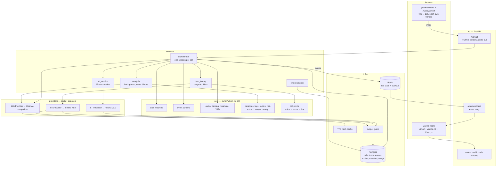

# Scam Dada

An AI scambaiting system for Indian phone scams. When a scam call is flagged, an elderly
persona — **Dada**, a 74-year-old retired Railways clerk — takes the call, keeps the scammer
engaged in Hinglish for as long as possible, and hands him to the grandson when he starts to
lose patience. Everything the scammer says is extracted into an evidence pack: UPI handles,
fake officer names, the shape of the script.

Built for the Great Indian AI Internship Challenge on Gnani's speech models.

> **Status: Phase 1 complete, personas drafted.** The three provider adapters work against
> the live APIs. Nothing in this README is a claimed capability unless it is listed as done
> below.

## What works today

| | |
|---|---|
| Scaffold | FastAPI app, Docker Compose (api + postgres + redis), JSON logging with `call_id` |
| Schema | 7 tables, two Alembic migrations, verified against Postgres 16 with no ORM drift |
| Event model | 8 typed events behind a discriminated union, round-trip tested |
| Audio layer | 48k→16k resampling, 1024-byte framing, energy VAD with hysteresis — all pure and tested |
| **Prisma v3.0 STT** | Streaming WebSocket adapter: upgrade headers, exact 1024-byte frames, VAD events, usage metering, 15-minute cap surfaced for rotation |
| **Timbre v3.0 TTS** | SSE adapter returning raw PCM, inline audio tags, four error shapes normalised |
| **LLM** | OpenAI-compatible adapter, streaming + validated JSON, automatic fallback to a second model |
| **TTS cache** | Content-hash cache; hits cost nothing and record what they avoided |
| **Budget guard** | Credits (₹) per pool with a hard stop, raw units kept for auditability |
| **Voice ageing** | Pitch, WSOLA tempo, tremble with aperiodic jitter, and an audible breath before the first word — Timbre has no elderly voice, so Dada's is made in DSP |
| **Room** | Synthetic ceiling fan, mains hum, street and room floor, plus a short reverb that puts the voice *in* the room rather than over it |
| **Phone line** | Handset presence bump, carrier AGC, 8 kHz narrowband, G.711 mu-law companding, packet loss with concealment |
| **Call profiles** | The three stages composed in the one order that is physically correct, as a six-rung ladder from `studio` to `bad-line` |
| **Voice-to-room ratio** | Referenced to speech level, and equalised across lines so the *delivered* ratio (~10.5 dB measured) does not change when the line does |
| **Persona voices** | Dada is Devansh on `bad-line`; the grandson is derived from the same profile so the room and carrier cannot change when the handset does. Startup fails if both personas are given one voice |
| **Audio tags** | The 13-tag Timbre v3.0 catalogue, with a per-persona allowed set; unknown tags are billed and then discarded by the API, so they are stripped first |
| **Personas** | Dada and grandson prompts, ethics block shared and digest-pinned, relay registry |
| Tests | 391 offline + 64 contract, `ruff` and `mypy` clean (`mypy --strict` on `core` and `providers`) |

Measured on the live APIs by `make smoke` (n=1 per provider, 2026-11-04):

| leg | latency |
|---|---|
| Timbre first audio byte | 304 ms |
| Timbre cached replay | 4 ms |
| Prisma `speech_start` → transcript (3.3 s clip) | 1208 ms; Prisma self-reports 69 ms per segment |
| LLM first token (`qwen/qwen3.8-27b`) | 174–380 ms over three runs |
| LLM validated JSON (`openai/gpt-oss-120b`) | 762–1769 ms |
| Fallback recovery after a 404 | 595–813 ms |

Not built yet: the orchestrator, the intelligence layer, the dashboard and the evidence
pack. The persona prompts exist but nothing drives them yet. See [PLAN.md](PLAN.md) for the phase plan and
[docs/DECISIONS.md](docs/DECISIONS.md) for why the architecture looks like this.

## Which Gnani models are used, and where

| Model | Role | Where |
|---|---|---|
| **Prisma v3.0** | Streaming speech-to-text | [`app/providers/gnani_prisma.py`](app/providers/gnani_prisma.py). `language_code=indic-auto` so a scammer switching language mid-call still transcribes, and `format=transliterate` because it was the only format that returned Latin-script Hinglish intact — see DECISIONS 0009. |
| **Timbre v3.0** | Expressive text-to-speech | [`app/providers/gnani_timbre.py`](app/providers/gnani_timbre.py). v3.0 specifically, because inline audio tags only work on v3.0 — v2.5 strips them silently. A tag applies from where it sits to the end of the input, so one `<slow>` costs six characters and slows a whole utterance. `language=hi-en` for Hinglish, over SSE, as headerless raw PCM. |
| **Voice cloning** (`vachana-vc-v1`) | Not used | Reachable and documented, but it is a **different model** from `timbre-v3.0`, and audio tags are v3.0-only. Cloning would cost `<slow>`, `<coughs>`, `<sigh>` and `<pauses>` — the four tags Dada's prompt is built on. Its request body also has no `language` field, so Hinglish behaviour is undocumented. Traded away deliberately; see DECISIONS 0018. |
| **Evon v3.3** | Dialogue and analysis LLM | **Not used — it is not reachable.** Gnani's FAQ says Evon is not on the API platform (open weights by request on Hugging Face). The Agent Builder's model list returns Claude, GPT-4.1-mini, GPT-4o-mini and Gnani's "Pampa" models, no Evon, and it is a selector for agents rather than a completions endpoint. The LLM therefore sits behind `LLMProvider` with an OpenAI-compatible adapter; pointing it at Evon is one environment variable. |

## Architecture

Dependencies point inward only. `app/core` imports nothing from FastAPI, SQLAlchemy, Redis
or any provider SDK, so the state machine, the audio maths and the scoring are testable with
no mocks at all.



## Setup

Requires Python 3.11+, Docker, and `uv`.

```bash
cp .env.example .env     # then fill in GNANI_API_KEY and the LLM_* values
make install             # venv on 3.11 + dev dependencies
make up                  # postgres + redis
make migrate             # apply the baseline schema
make test                # 391 tests, offline, zero API cost
make dev                 # api on http://localhost:8000
```

Or the whole stack in containers:

```bash
docker compose up        # api + postgres + redis
curl localhost:8000/readyz
```

`/readyz` reports datastore reachability **and which provider adapters are wired**, so a
demo-day misconfiguration (mock TTS still selected) is one request away rather than a
surprise on stage.

### Commands

| | |
|---|---|
| `make test` | Unit + integration, offline, no credits spent |
| `make test-contract` | Adapters against recorded sample payloads, still offline |
| `make smoke` | **Spends credits.** One real call per provider end to end; prints latency and cost |
| `make audition` | **Spends credits.** One line in every Timbre v3.0 voice. `ARGS="--male"` for the male set |
| `make audition-male` | **Spends credits** (6 requests). Every male voice at Dada's chosen profile, to compare voices |
| `make audition-ladder` | 1 request, or free from cache. One voice through all six realism profiles, to choose a profile |
| `python scripts/audition_voices.py --male --grandson` | **Spends credits** (6 requests). The grandson's own line in every male voice, unaged, on Dada's room and line |
| `make lint` / `make fmt` / `make types` | `ruff` and `mypy` |
| `make check` | Everything that gates a phase |
| `make revision m="..."` | Autogenerate a migration |

## Constraints this project holds itself to

**Synthetic data only.** No real phone numbers, account numbers, Aadhaar, PAN, card numbers
or recorded calls appear anywhere — not in code, fixtures, seeds or demos. Every identifier
the system generates is visibly fake: reserved number ranges, fictional names, UPI handles
on `@demo`. The mock scammer script is asserted to be fictional by a test, and the canary
generator will be too.

**Ethics guardrails in the persona prompts.** Neither persona ever threatens, insults,
claims to be police, offers to call anyone back, or tries to identify or locate a real
person. The constraints live in one file, [`app/prompts/ethics.v1.md`](app/prompts/ethics.v1.md),
shared verbatim by every persona, and its sha256 is pinned by a test — so changing it fails
the suite until someone updates the digest on purpose. Six named constraints are asserted
individually, and no persona may use the `<laugh>`, `<giggle>`, `<shouting>` or `<excited>`
audio tags, because a laugh in the middle of a scam call is mockery and mockery is ruled out.

**No hardcoded results.** Every number in this README and in the dashboard comes from a
logged run and is reported with its sample size. The "117 tests passing" above is the output
of `make test` at the Phase 0 commit.

**Credit discipline.** Every TTS output is cached by content hash and never re-synthesised.
The budget guard tracks spend in credits (₹1 each) against a configurable total with a hard
stop that sits short of the balance, so there is always credit left to re-record the demo.
STT is modelled as **billed minutes with rounding**, not raw seconds, because Gnani rounds a
2.7-second call up to 0.05 minutes. Raw units are stored next to every credit figure so the
conversion stays verifiable.

The rates themselves are **placeholders inferred from a six-request sample** until
`RATES_CONFIRMED=true` is set, and until then every charge is flagged `estimated=True` and
the smoke script says so in its header. Gnani's own pool and the LLM vendor's are tracked
separately, because Groq spend does not consume Gnani credits and mixing them would hide a
real limit.

## Known limitations

- **Evon is not used.** See the model table above. The adapter seam exists; the model does not.
- **Prisma caps a streaming session at 15 minutes.** Handled by rotating sessions behind the
  STT port (Phase 2), which is invisible to the orchestrator but means a scambait longer than
  15 minutes spans more than one upstream session.
- **Prisma returns no partial transcripts** (`is_final` is always true), so turn-taking relies
  on its VAD events rather than stabilising partials. Barge-in therefore uses a local energy
  VAD; see [docs/DECISIONS.md](docs/DECISIONS.md) 0002 and 0003.
- **Prisma was not observed to emit the documented `processing` event.** A live session
  produced `ready > speech_start > transcript` only. There is therefore no server-side
  end-of-speech signal, and filler-phrase timing has to come from the local VAD closing its
  gate (DECISIONS 0012). The smoke script prints the observed event sequence on every run.
- **The credit rates are estimates.** See the credit-discipline note above.
- **The dialogue model is a Groq preview model.** `qwen/qwen3.8-27b` can be withdrawn without
  notice, so a fallback to `openai/gpt-oss-120b` is wired in — but only before the first
  token, because switching mid-sentence would splice two different replies (DECISIONS 0014).
- **Timbre documents no cancel message** on either streaming transport, so an interrupted
  reply is abandoned client-side rather than cancelled upstream. Audio already synthesised
  has already been billed.
- **The call chain runs per utterance, not per chunk.** Measured at 0–145 ms for a 13 s
  render (~1% of real time), but the WSOLA time-stretch needs lookahead, so today the whole
  utterance is processed before the first byte goes out. Fillers will be rendered once at
  cache-write time; a chunk-wise stretch with one frame of lookahead is the fix if the
  per-utterance cost shows up in the live path.
- **The bed's level dial is not calibrated to the output, and the offset differs per line.**
  `level_db` is set against the voice before the line; each line's AGC then lifts the
  bed-only passages toward its target by a different amount. On `landline` −15 dB nominal
  delivers 8.2 dB; on `bad-line` the same figure delivers 3.7 dB. The nominal levels
  therefore differ *in order to* equalise the delivered ratio at ~10.5 dB. Only measured
  figures are quoted anywhere, and tests pin the relationship (DECISIONS 0020, 0021).
- **`bad-line` is the aggressive end of the ladder, chosen deliberately.** A bad connection
  masks synthesis artefacts and forces the scammer to repeat himself, which is the goal —
  but it also gives him a reason to call back on a better line. That is hang-up risk, and
  feature 3 has to work with it rather than against it.
- **The room tone is generated, not recorded.** A fan, mains hum, traffic and a room floor
  from noise and sinusoids. It is convincing in a phone band, and it means no audio had to be
  sourced, licensed or committed — but it is not a real room, and a trained ear listening for
  it on a wideband monitor will hear that.
- **Timbre's output is not byte-identical between runs.** The same text and voice came back
  10.3 s long on one run and 10.2 s on another, so the TTS cache is the only way to get a
  reproducible demo, not merely a cheaper one.
- **The documented TTS character count does not match its own example.** Gnani's billing
  example says a 39-character string bills as 42. `billable_characters` is plain `len` until
  one real invoice line settles it; if the docs are right, TTS estimates are ~8% low on short
  utterances (DECISIONS 0016).
- **Resampling is linear interpolation**, not a polyphase filter. Adequate for 48k→16k speech
  into an ASR trained on telephone audio; revisit if transcript quality is the bottleneck.
- **Browser only.** There is no telephony leg. Input is a live microphone or a replayed
  synthetic scammer WAV.
- **One Alembic baseline, no incremental migrations** during contest week. Deliberate: see
  PLAN.md §0.

## Repository layout

```
app/
  api/        routes, websocket handlers, dependency wiring (the composition root)
  core/       state machine, events, audio, personas, tactics, risk, canaries  [pure]
  services/   orchestrator, stt session rotation, turn taking, analysis, evidence
  providers/  the three Protocol ports + gnani/openai-compatible/mock adapters
  infra/      settings, db, redis bus, budget guard, tts cache, logging
  web/        Jinja templates, audio worklets, dashboard JS
  prompts/    persona and analysis prompts, versioned as files
scripts/      voice audition, filler pre-generation, smoke test, seeds
tests/        unit/ integration/ contract/ fixtures/
docs/         DECISIONS.md — one entry per hard-to-reverse choice
```

## Licence and intent

Built as a contest entry and portfolio project. It is a research and deterrence tool
operated against inbound scam calls, with synthetic identities only, and it does not
identify, locate or retaliate against anyone.
