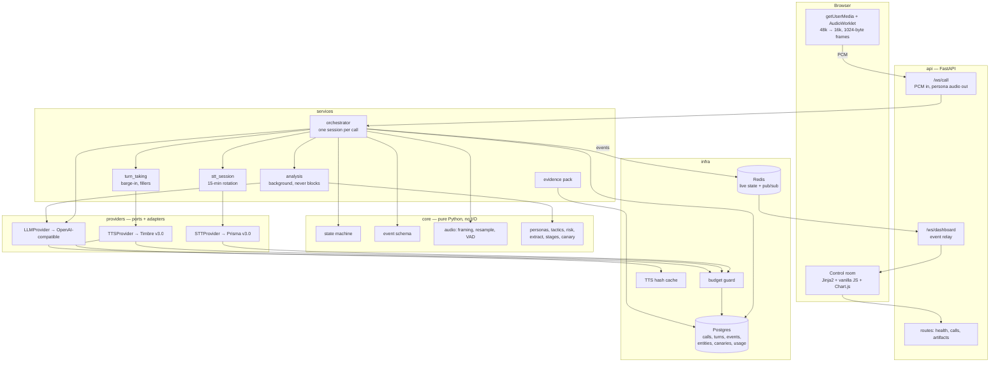

# Scam Dadi

An AI scambaiting system for Indian phone scams. When a scam call is flagged, an elderly
persona ("Dadi") takes the call, keeps the scammer engaged in Hinglish for as long as
possible, and extracts intelligence — UPI handles, fake officer names, scam scripts — into
an evidence pack.

Built for the Great Indian AI Internship Challenge on Gnani's speech models.

> **Status: Phase 0 complete.** Scaffold, schema, event model, pure audio layer and offline
> mock providers. The real Gnani adapters land in Phase 1. Nothing in this README is a
> claimed capability unless it is listed as done below.

## What works today

| | |
|---|---|
| Scaffold | FastAPI app, Docker Compose (api + postgres + redis), JSON logging with `call_id` |
| Schema | 7 tables, one Alembic baseline, verified against Postgres 16 with no ORM drift |
| Event model | 8 typed events behind a discriminated union, round-trip tested |
| Audio layer | 48k→16k resampling, 1024-byte framing, energy VAD with hysteresis — all pure and tested |
| Providers | Three `Protocol` ports; deterministic offline mocks for all of them |
| Tests | 117 passing, `ruff` and `mypy` clean (`mypy --strict` on `core` and `providers`) |

Not built yet: the Gnani adapters, the orchestrator, personas, the intelligence layer, the
dashboard and the evidence pack. See [PLAN.md](PLAN.md) for the phase plan and
[docs/DECISIONS.md](docs/DECISIONS.md) for why the architecture looks like this.

## Which Gnani models are used, and where

| Model | Role | Where |
|---|---|---|
| **Prisma v3.0** | Streaming speech-to-text | `app/providers/gnani_prisma.py` (Phase 1). `indic-auto` so a scammer switching language mid-call still transcribes. |
| **Timbre v3.0** | Expressive text-to-speech | `app/providers/gnani_timbre.py` (Phase 1). v3.0 specifically, because inline audio tags (`<sigh>`, `<pauses>`, `<whispers>`) only work on v3.0 — v2.5 strips them silently. `language=hi-en` for Hinglish. |
| **Evon v3.3** | Dialogue and analysis LLM | **Not used — it is not reachable.** Gnani's FAQ says Evon is not on the API platform (open weights by request on Hugging Face). The Agent Builder's model list returns Claude, GPT-4.1-mini, GPT-4o-mini and Gnani's "Pampa" models, no Evon, and it is a selector for agents rather than a completions endpoint. The LLM therefore sits behind `LLMProvider` with an OpenAI-compatible adapter; pointing it at Evon is one environment variable. |

## Architecture

Dependencies point inward only. `app/core` imports nothing from FastAPI, SQLAlchemy, Redis
or any provider SDK, so the state machine, the audio maths and the scoring are testable with
no mocks at all.



## Setup

Requires Python 3.11+, Docker, and `uv`.

```bash
cp .env.example .env     # then fill in GNANI_API_KEY and the LLM_* values
make install             # venv on 3.11 + dev dependencies
make up                  # postgres + redis
make migrate             # apply the baseline schema
make test                # 117 tests, offline, zero API cost
make dev                 # api on http://localhost:8000
```

Or the whole stack in containers:

```bash
docker compose up        # api + postgres + redis
curl localhost:8000/readyz
```

`/readyz` reports datastore reachability **and which provider adapters are wired**, so a
demo-day misconfiguration (mock TTS still selected) is one request away rather than a
surprise on stage.

### Commands

| | |
|---|---|
| `make test` | Unit + integration, offline, no credits spent |
| `make test-contract` | Adapters against recorded sample payloads, still offline |
| `make lint` / `make fmt` / `make types` | `ruff` and `mypy` |
| `make check` | Everything that gates a phase |
| `make revision m="..."` | Autogenerate a migration |

## Constraints this project holds itself to

**Synthetic data only.** No real phone numbers, account numbers, Aadhaar, PAN, card numbers
or recorded calls appear anywhere — not in code, fixtures, seeds or demos. Every identifier
the system generates is visibly fake: reserved number ranges, fictional names, UPI handles
on `@demo`. The mock scammer script is asserted to be fictional by a test, and the canary
generator will be too.

**Ethics guardrails in the persona prompts.** Dadi never threatens, never insults, never
claims to be police, never calls anyone back, and never tries to identify or locate a real
person. These are hard constraints in the prompt files, with a test that the constraint block
is present and unmodified.

**No hardcoded results.** Every number in this README and in the dashboard comes from a
logged run and is reported with its sample size. The "117 tests passing" above is the output
of `make test` at the Phase 0 commit.

**Credit discipline.** Every TTS output is cached by content hash and never re-synthesised.
The budget guard counts raw units — TTS billable characters including tag characters, STT
audio seconds, LLM tokens — and refuses calls past a configurable ceiling. Cache hits are
recorded as zero-unit rows so "credits saved by caching" is measured rather than claimed.
Gnani publishes no credit conversion, so the guard deliberately does not pretend to know
the rupee cost.

## Known limitations

- **Evon is not used.** See the model table above. The adapter seam exists; the model does not.
- **Prisma caps a streaming session at 15 minutes.** Handled by rotating sessions behind the
  STT port (Phase 2), which is invisible to the orchestrator but means a scambait longer than
  15 minutes spans more than one upstream session.
- **Prisma returns no partial transcripts** (`is_final` is always true), so turn-taking relies
  on its VAD events rather than stabilising partials. Barge-in therefore uses a local energy
  VAD; see [docs/DECISIONS.md](docs/DECISIONS.md) 0002 and 0003.
- **Timbre documents no cancel message** on either streaming transport, so an interrupted
  reply is abandoned client-side rather than cancelled upstream. Audio already synthesised
  has already been billed.
- **Resampling is linear interpolation**, not a polyphase filter. Adequate for 48k→16k speech
  into an ASR trained on telephone audio; revisit if transcript quality is the bottleneck.
- **Browser only.** There is no telephony leg. Input is a live microphone or a replayed
  synthetic scammer WAV.
- **One Alembic baseline, no incremental migrations** during contest week. Deliberate: see
  PLAN.md §0.

## Repository layout

```
app/
  api/        routes, websocket handlers, dependency wiring (the composition root)
  core/       state machine, events, audio, personas, tactics, risk, canaries  [pure]
  services/   orchestrator, stt session rotation, turn taking, analysis, evidence
  providers/  the three Protocol ports + gnani/openai-compatible/mock adapters
  infra/      settings, db, redis bus, budget guard, tts cache, logging
  web/        Jinja templates, audio worklets, dashboard JS
  prompts/    persona and analysis prompts, versioned as files
scripts/      voice audition, filler pre-generation, smoke test, seeds
tests/        unit/ integration/ contract/ fixtures/
docs/         DECISIONS.md — one entry per hard-to-reverse choice
```

## Licence and intent

Built as a contest entry and portfolio project. It is a research and deterrence tool
operated against inbound scam calls, with synthetic identities only, and it does not
identify, locate or retaliate against anyone.
