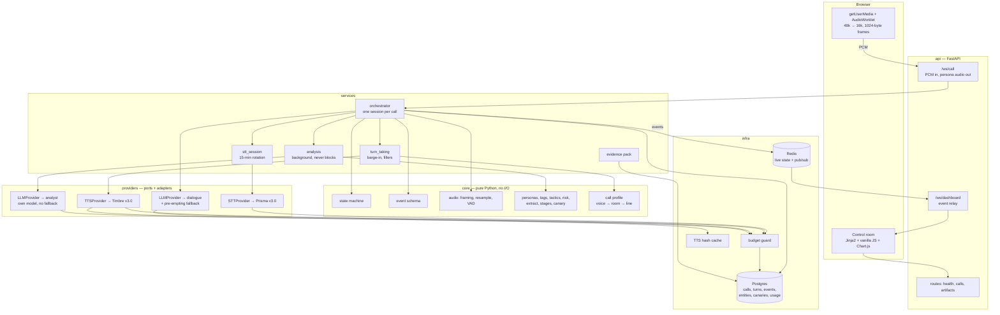

# Scam Dada

An AI scambaiting system for Indian phone scams. When a scam call is flagged, an elderly
persona — **Dada**, a 74-year-old retired Railways clerk — takes the call, keeps the caller
engaged in Hinglish for as long as possible, and hands him to the grandson when he starts to
lose patience. Everything the caller says is read back into an evidence pack: UPI handles,
destination accounts, claimed ranks and organisations, and the shape of the script he is
reading from.

Built for the Great Indian AI Internship Challenge on Gnani's speech models.

> **Status.** Phases 0–4 are complete and the system has been hardened against four rounds
> of live-call findings (DECISIONS 0028–0034). A scripted or microphone call runs end to end
> on the live APIs and produces a control-room view and a downloadable evidence pack.
> Nothing in this README is a claimed capability unless it is listed below, and every number
> is the output of a logged run reported with its sample size.

**Contents** — [How a call runs](#how-a-call-runs) · [What works today](#what-works-today) ·
[Measured performance](#measured-performance) · [Gnani models](#which-gnani-models-are-used-and-where) ·
[Architecture](#architecture) · [Setup](#setup) · [Commands](#commands) ·
[Engineering constraints](#engineering-constraints) · [Known limitations](#known-limitations)

## How a call runs

1. The call arrives at `/ws/call` as 16 kHz PCM — from a browser microphone, or from
   `scripts/fake_call.py` replaying a synthetic scammer so a demo take is reproducible.
2. **Prisma v3.0** transcribes it. A local energy VAD decides when the caller has stopped
   talking and when he is interrupting, because Prisma returns no partial transcripts.
3. The orchestrator builds one dialogue request — persona prompt, a six-turn window, and this
   turn's tactical note — and streams the reply, cutting at the first sentence boundary so
   synthesis starts before generation finishes.
4. Each sentence goes to **Timbre v3.0**, is aged into an elderly voice in DSP, placed in a
   room with a ceiling fan, and pushed down a narrowband phone line. It plays while the next
   sentence is still being generated; a filler phrase covers the gap on every turn.
5. In parallel, a deterministic keyword pass and a model pass read the transcript for scam
   stage, pressure, hang-up risk and identifiers. The keyword pass is what the dashboard
   shows; the model pass adds what regex cannot see and never blocks the dialogue path.
6. When hang-up risk rises the persona plays a retention tactic; when the caller insists he
   is handed to the grandson. At any point the evidence pack is one request away.

## What works today

### Speech and audio

| | |
|---|---|
| **Prisma v3.0 STT** | Streaming WebSocket adapter: upgrade headers, exact 1024-byte frames, VAD events, usage metering, the 15-minute session cap surfaced for rotation |
| **Timbre v3.0 TTS** | SSE adapter returning raw PCM, inline audio tags, four error shapes normalised to one taxonomy |
| **Audio layer** | 48k→16k resampling, 1024-byte framing, energy VAD with hysteresis — pure functions, no I/O, fully tested |
| **Voice ageing** | Pitch shift, WSOLA tempo, tremble with aperiodic jitter, and an audible breath before the first word. Timbre has no elderly voice, so Dada's is made in DSP |
| **Room** | Synthetic ceiling fan, mains hum, street and room floor, plus a short reverb that puts the voice *in* the room rather than over it |
| **Phone line** | Handset presence bump, carrier AGC, 8 kHz narrowband, G.711 mu-law companding, packet loss with concealment |
| **Call profiles** | The three stages composed in the one order that is physically correct, as a six-rung ladder from `studio` to `bad-line` |
| **Voice-to-room ratio** | Referenced to speech level and equalised across lines, so the *delivered* ratio (~10.5 dB measured) does not change when the line does |
| **Continuous room tone** | The line never goes digitally silent: the bed plays between utterances from the same loop position, so the fan does not restart when the persona stops |
| **Audio tags** | The 13-tag Timbre v3.0 catalogue with a per-persona allowed set. Unknown tags are billed and then discarded upstream, so they are stripped before the request |

### Conversation

| | |
|---|---|
| **Personas** | Dada and grandson prompts as versioned files, a shared ethics block pinned by sha256, and a relay registry |
| **Persona voices** | Both personas are Devansh on `bad-line` — relatives share timbre — pushed apart in processing to +2.26 semitones and 20% in rate. Startup fails only if two personas would render *identically* |
| **Orchestrator** | One object per call: rotating STT, local VAD, barge-in, fillers, sentence-by-sentence replies, per-turn latency |
| **Turn-taking** | Replies cut at the first sentence boundary; handles decimals, audio tags and unpunctuated run-ons |
| **Turn note** | Language and reply length are stated in a 64-token system note in *last* position on every turn rather than in the prompt, because form rules drift when the model is attending to what to say. Length is given as a range: a ceiling alone collapsed replies to 33 characters, and truncation feeds back through the transcript (DECISIONS 0031, 0032) |
| **STT rotation** | Prisma's 15-minute cap becomes a seam, not a hang-up — rotated before the cap, deferred mid-utterance, and reactive if the session dies at it |
| **LLM routing** | Three models for three jobs behind one port, with pre-emptive switching off the rate-limit headers (see below) |

### Intelligence

| | |
|---|---|
| **Entity extraction** | Regex-only and reproducible: UPI handles, Indian mobiles, IFSC, destination account numbers, case numbers, claimed organisations and ranks, and Hinglish amounts (`do lakh`, `paanch hazaar`, `2.5 lakh`). Dictated digits are read too — Prisma transcribes `zero zero one one` as words, which no digit pattern matches |
| **LLM analysis** | A validated-JSON second opinion that adds what regex cannot see, never blocks the dialogue path, and degrades to the keyword pass when the model is down. Runs on its **own** model, every third caller turn — except at the payment stage, where every turn is read, because the account number, the IFSC and the payee name are each said exactly once |
| **Scam stages** | Five stages scored from keyword evidence, monotonic so the badge never retreats, with a pressure gauge whose signals are shown beside it |
| **Hang-up risk** | Named signals only, including two a phrase list cannot see — replies shortening, and recency — feeding a bait-hook selector |
| **Bait hooks** | Seven retention tactics, chosen by stage and used once each. Instructions rather than scripts, and none pleads or promises a payment |
| **Payment elicitation** | The one window where a scammer volunteers his own payee details, so reaching the `payment` stage arms an elicitation hook regardless of hang-up risk. The persona accepts and then needs one more thing first — a slip for the bank counter, a name the clerk will ask for, a fallback account. Nothing is ever paid and no identifier of the persona's own is improvised (DECISIONS 0033) |
| **Canary identities** | One provably-unusable fictional identity per call, matched against every earlier one — including when the caller reads it back aloud digit by digit |

### Platform and interfaces

| | |
|---|---|
| **Scaffold** | FastAPI app, Docker Compose (api + postgres + redis), structured JSON logging keyed by `call_id` |
| **Schema** | 7 tables, two Alembic migrations, verified against Postgres 16 with no ORM drift |
| **Event model** | 8 typed events behind a discriminated union, round-trip tested |
| **Call transport** | `/ws/call`: PCM in, persona audio out, JSON control on the same socket, with an explicit flush so barge-in is instant |
| **Browser simulator** | `/` — two AudioWorklets: capture resamples to 16 kHz and frames to 1024 bytes, playback is a ring buffer so barge-in can drop queued audio |
| **Live demo page** | `/demo` — microphone, who-is-speaking and an echo warning on the left, the live dashboard on the right. One screen, one call, no tab switching |
| **Replay** | `/demo?replay=<call_id>` plays a finished call back through the same panels, so the visuals can be rehearsed without talking |
| **Control room** | `/dashboard` — live call list, stage ladder, pressure and risk gauges with their signals, transcript, extracted intelligence with provenance, per-turn latency |
| **Read API** | `/api/calls`, `/api/calls/{id}`, and `/api/calls/{id}/events?after_seq=` for a dashboard that reconnected mid-call |
| **Evidence pack** | HTML and PDF per call: headline minutes wasted, every identifier with the machine that found it, identity leaks, latency distribution, full transcript |
| **Scripted call driver** | `scripts/fake_call.py` runs a whole call with no microphone, so a demo take is reproducible |
| **TTS cache** | Content-hash cache; hits cost nothing and record what they avoided |
| **Budget guard** | Credits (₹) per pool with a hard stop, raw units retained for auditability |
| **Token budget** | Every model is capped at 8000 tokens a minute, **per model**, so dialogue, its fallback and the analyst run on three. Requests are priced by `scripts/token_budget.py` against the vendor's own `usage`, and a test holds the ceiling. A near-empty budget is read off the response headers and the next turn moves models before the refusal; a refusal that happens anyway rests that model for the `retry-after` it asked for, and a turn with nowhere to go stalls on filler and is asked for once more (DECISIONS 0034) |
| **Tests** | 1219 offline + 74 contract, `ruff` and `mypy` clean (`mypy --strict` on `core` and `providers`) |

Not built yet: the robocall-versus-human check (feature 6) and Guardian Mode's handoff
trigger. Both are modelled in the state machine, but a call is currently assumed to be a
human. See [PLAN.md](PLAN.md) for the phase plan and [docs/DECISIONS.md](docs/DECISIONS.md)
for why the architecture looks like this.

## Measured performance

Per turn, from the caller stopping speaking, across two consecutive live calls through the
orchestrator (2026-11-06):

| leg | range |
|---|---|
| End of speech → transcript | 448–565 ms |
| LLM first token | 243–706 ms |
| TTS first audio | 54–860 ms |
| Filler phrase played | every turn |

Against the live APIs, by `make smoke` (n=1 per provider, 2026-11-04):

| leg | latency |
|---|---|
| Timbre first audio byte | 304 ms |
| Timbre cached replay | 4 ms |
| Prisma `speech_start` → transcript (3.3 s clip) | 1208 ms; Prisma self-reports 69 ms per segment |
| LLM first token (`qwen/qwen3.8-27b`) | 174–380 ms over three runs |
| LLM validated JSON (`openai/gpt-oss-120b`) | 762–1769 ms |
| Fallback recovery after a 404 | 595–813 ms |

One real recorded call (2026-11-06), read back through the API:

| | |
|---|---|
| Caller time consumed | 49.1 s across 6 caller turns |
| Scam stage timeline | `authority → fear → payment` |
| Peak pressure applied | 0.85 |
| Identifiers extracted | 6, with provenance (2 regex, 4 model) |
| Identity leaks | 1, attributed to the call that issued the canary |
| Latency, n=6 | transcript 519 ms median · first token 273 ms (p95 1394) · first audio 472 ms |

Token spend per request, from the vendor's own `usage` block (2026-11-08), before and after
the budget work in DECISIONS 0034:

| | before | after |
|---|---|---|
| Dialogue, one turn | 1773 | 1498 |
| Analysis, one pass | 3315 across two billed requests | 1281 in one |
| `qwen/qwen3.8-27b` at 5 caller turns/min | 8865 — 111% of the cap | 6200 — 78% |
| `openai/gpt-oss-120b` at 5 caller turns/min | 8288 — 104%, before dialogue spilled onto it | 1341 — 17% |
| `openai/gpt-oss-20b` at 5 caller turns/min | unused | 1600 — 20% |

## Which Gnani models are used, and where

| Model | Role | Where |
|---|---|---|
| **Prisma v3.0** | Streaming speech-to-text | [`app/providers/gnani_prisma.py`](app/providers/gnani_prisma.py). `language_code=indic-auto` so a caller switching language mid-call still transcribes, and `format=transliterate` because it was the only format that returned Latin-script Hinglish intact (DECISIONS 0009). |
| **Timbre v3.0** | Expressive text-to-speech | [`app/providers/gnani_timbre.py`](app/providers/gnani_timbre.py). v3.0 specifically, because inline audio tags only work on v3.0 — v2.5 strips them silently. A tag applies from where it sits to the end of the input, so one `<slow>` costs six characters and slows a whole utterance. `language=hi-en` for Hinglish, over SSE, as headerless raw PCM. |
| **Voice cloning** (`vachana-vc-v1`) | Not used | Reachable and documented, but a **different model** from `timbre-v3.0`, and audio tags are v3.0-only. Cloning would cost `<slow>`, `<coughs>`, `<sigh>` and `<pauses>` — the four tags Dada's prompt is built on. Its request body also has no `language` field, so Hinglish behaviour is undocumented. Traded away deliberately (DECISIONS 0018). |
| **Evon v3.3** | Dialogue and analysis LLM | **Not used — not reachable.** Gnani's FAQ says Evon is not on the API platform (open weights by request on Hugging Face). The Agent Builder's model list returns Claude, GPT-4.1-mini, GPT-4o-mini and Gnani's "Pampa" models, no Evon, and it is a selector for agents rather than a completions endpoint. The LLM therefore sits behind `LLMProvider` with an OpenAI-compatible adapter; pointing it at Evon is one environment variable. |

The LLM work is split across three models because the token cap is per model, not per
account:

| Job | Model | Notes |
|---|---|---|
| Dialogue | `qwen/qwen3.8-27b` | Streaming, sentence-at-a-time |
| Dialogue fallback | `openai/gpt-oss-120b` | Entered before the first token only — switching mid-sentence would splice two replies (DECISIONS 0014) |
| Analysis | `openai/gpt-oss-20b` | Its own bucket and **no fallback wrapper**: a failed analysis is designed to degrade to the keyword pass, so retrying it would spend budget the caller is waiting on |

## Architecture

Dependencies point inward only. `app/core` imports nothing from FastAPI, SQLAlchemy, Redis
or any provider SDK, so the state machine, the audio maths and the scoring are testable with
no mocks at all. Vendor names appear only under `app/providers/`.



## Setup

Requires Python 3.11+, Docker, and `uv`.

```bash
cp .env.example .env     # then fill in GNANI_API_KEY and the LLM_* values
make install             # venv on 3.11 + dev dependencies
make up                  # postgres + redis
make migrate             # apply the baseline schema
make test                # 1219 tests, offline, zero API cost
make dev                 # api on http://localhost:8000
```

Or the whole stack in containers:

```bash
docker compose up        # api + postgres + redis
curl localhost:8000/readyz
```

`/readyz` reports datastore reachability **and which provider adapters are wired**, so a
demo-day misconfiguration (mock TTS still selected) is one request away rather than a
surprise on stage.

Four pages: `/demo` is the live demo screen, `/` is the plain call simulator, `/dashboard` is
the control room over every call, and `/api/calls/{id}/evidence.html` is a call's evidence
pack. The PDF version needs `pip install -e '.[pdf]'` plus its system libraries
(`brew install pango` on macOS); without them the route answers 503 and says so, and the HTML
pack needs neither.

### Commands

| | |
|---|---|
| `make test` | Unit + integration, offline, no credits spent |
| `make test-contract` | Adapters against recorded sample payloads, still offline |
| `make lint` / `make fmt` / `make types` | `ruff` and `mypy` |
| `make check` | Everything that gates a phase: lint, types, both suites |
| `make revision m="..."` | Autogenerate a migration |
| `make smoke` | **Spends credits.** One real call per provider end to end; prints latency and cost |
| `make audition` | **Spends credits.** One line in every Timbre v3.0 voice. `ARGS="--male"` for the male set |
| `make audition-male` | **Spends credits** (6 requests). Every male voice at Dada's chosen profile, to compare voices |
| `make audition-ladder` | 1 request, or free from cache. One voice through all six realism profiles, to choose a profile |
| `python scripts/fake_call.py` | **Spends credits** on the first run, then free from cache. Drives a whole scripted call over the WebSocket, with no microphone |
| `python scripts/fake_call.py --leak` | As above, but the caller quotes a canary issued to an earlier call — the identity-leak demo |
| `python scripts/token_budget.py` | Free. Prices the real dialogue and analysis requests against the 8000-tokens-per-minute cap and prints the turn rate each model supports |
| `python scripts/token_budget.py --live` | **Spends a few thousand tokens** (3 requests). Adds the vendor's own completion counts and limit headers, so the figures are measured rather than estimated |
| `python scripts/audition_voices.py --male --grandson` | **Spends credits** (6 requests). The grandson's own line in every male voice, on Dada's room and line |
| `python scripts/audition_voices.py --voices Devansh --handoff` | Free from cache. Dada then the grandson in one clip, room tone continuous across the join — the only way to judge whether the relay reads as two people |

## Engineering constraints

**Synthetic data only.** No real phone numbers, account numbers, Aadhaar, PAN, card numbers
or recorded calls appear anywhere — not in code, fixtures, seeds or demos. Every identifier
the system generates is visibly fake: reserved number ranges, fictional names, UPI handles on
`@demo`. Both the mock scammer script and the canary generator are asserted to be fictional
by tests, which check for Aadhaar and PAN shapes, real mobile ranges, allocated bank codes
and real localities.

**Ethics guardrails in the persona prompts.** Neither persona ever threatens, insults, claims
to be police, offers to call anyone back, or tries to identify or locate a real person. The
constraints live in one file, [`app/prompts/ethics.v1.md`](app/prompts/ethics.v1.md), shared
verbatim by every persona, and its sha256 is pinned by a test — so changing it fails the
suite until someone updates the digest on purpose. Six named constraints are asserted
individually, and no persona may use the `<laugh>`, `<giggle>`, `<shouting>` or `<excited>`
audio tags, because a laugh in the middle of a scam call is mockery and mockery is ruled out.

**No hardcoded results.** Every number in this README and in the dashboard comes from a logged
run and is reported with its sample size. The test counts above are the output of
`make test` and `make test-contract` at the current commit; the latency tables name the date
and the number of calls they were measured on.

**Credit discipline.** Every TTS output is cached by content hash and never re-synthesised.
The budget guard tracks spend in credits (₹1 each) against a configurable total with a hard
stop that sits short of the balance, so there is always credit left to re-record the demo.
STT is modelled as **billed minutes with rounding**, not raw seconds, because Gnani rounds a
2.7-second call up to 0.05 minutes. Raw units are stored next to every credit figure so the
conversion stays verifiable.

The rates themselves are **placeholders inferred from a six-request sample** until
`RATES_CONFIRMED=true` is set, and until then every charge is flagged `estimated=True` and the
smoke script says so in its header. Gnani's own pool and the LLM vendor's are tracked
separately, because LLM spend does not consume Gnani credits and mixing them would hide a
real limit.

**No secrets in the repository.** All configuration comes from the environment through
`pydantic-settings`; no key is ever logged or printed, including in error paths.

## Known limitations

### Model and vendor

- **Evon is not used.** See the model table above. The adapter seam exists; the model does not.
- **Prisma caps a streaming session at 15 minutes.** Handled by rotating sessions behind the
  STT port, which is invisible to the orchestrator but means a scambait longer than 15
  minutes spans more than one upstream session.
- **Prisma returns no partial transcripts** (`is_final` is always true), so turn-taking relies
  on its VAD events rather than stabilising partials. Barge-in therefore uses a local energy
  VAD (DECISIONS 0002, 0003).
- **Prisma was not observed to emit the documented `processing` event.** A live session
  produced `ready > speech_start > transcript` only. There is therefore no server-side
  end-of-speech signal, and filler timing has to come from the local VAD closing its gate
  (DECISIONS 0012). The smoke script prints the observed event sequence on every run.
- **Timbre documents no cancel message** on either streaming transport, so an interrupted
  reply is abandoned client-side rather than cancelled upstream. Audio already synthesised
  has already been billed.
- **TTS concurrency is one.** Timbre refuses a second active request per API key with
  `429 Only 1 active request is allowed at a time`, so synthesis is serialised in the adapter.
  Two simultaneous calls would queue behind each other (DECISIONS 0023).
- **Timbre's output is not byte-identical between runs.** The same text and voice came back
  10.3 s long on one run and 10.2 s on another, so the TTS cache is the only way to get a
  reproducible demo, not merely a cheaper one.
- **The documented TTS character count does not match its own example.** Gnani's billing
  example says a 39-character string bills as 42. `billable_characters` is plain `len` until
  one real invoice line settles it; if the docs are right, TTS estimates are ~8% low on short
  utterances (DECISIONS 0016).
- **The credit rates are estimates.** See the credit-discipline note above.
- **The dialogue model is a preview model.** `qwen/qwen3.8-27b` can be withdrawn without
  notice, which is why the fallback exists.
- **Dialogue output is not always clean.** One live call produced a few characters of Arabic
  script mid-reply. The fallback handles errors, not nonsense; nothing filters unexpected
  scripts before synthesis yet.
- **Token limits bound the call pace, and one of them is invisible.** Every model is capped at
  8000 tokens a minute, **per model**, so the three jobs no longer compete and
  `scripts/token_budget.py` reports clean up to nine caller turns a minute — a fast call runs
  at about five. There is also a **200,000-tokens-per-day** cap that no response header
  reports: it appears only in the body of the 429 that enforces it, so it cannot be
  pre-empted, only recovered from. That is roughly a dozen full calls, which is a real
  constraint on a day of rehearsing (DECISIONS 0034).

### Conversation and audio

- **Barge-in and speakers are in tension.** The microphone hears the persona, so barge-in
  needs a much higher bar while it is speaking: 256 ms of sustained speech above four times
  the VAD threshold. That makes speakers survivable, not good — headphones are the actual
  answer, and there is an off switch on the page (DECISIONS 0030).
- **An interrupted reply is dropped, not recorded.** A sentence cut off by barge-in never
  reaches the transcript or the evidence pack, because recording it would put words in the
  persona's mouth that the caller never heard. A call with heavy interruption therefore shows
  fewer persona turns than the model actually generated.
- **The filler starts on the transcript, not on the VAD closing.** DECISIONS 0012 reasoned it
  should start earlier; the code deliberately does not, because the VAD gate needs 384 ms of
  silence and ordinary mid-sentence pauses are longer than that, so firing there would make
  the persona talk over the caller. It therefore covers the LLM and TTS legs but not the
  450–565 ms of transcription (DECISIONS 0024).
- **The call chain runs per utterance, not per chunk.** Measured at 0–145 ms for a 13 s render
  (~1% of real time), but the WSOLA time-stretch needs lookahead, so the whole utterance is
  processed before the first byte goes out. A chunk-wise stretch with one frame of lookahead
  is the fix if this ever shows up in the live path.
- **The bed's level dial is not calibrated to the output, and the offset differs per line.**
  `level_db` is set against the voice before the line; each line's AGC then lifts the
  bed-only passages toward its target by a different amount. On `landline` −15 dB nominal
  delivers 8.2 dB; on `bad-line` the same figure delivers 3.7 dB. The nominal levels therefore
  differ *in order to* equalise the delivered ratio at ~10.5 dB. Only measured figures are
  quoted anywhere, and tests pin the relationship (DECISIONS 0020, 0021).
- **Both personas share one Timbre voice.** Deliberate — relatives sound related — but the
  separation is 2.26 semitones and 20% in speaking rate, which is measured rather than
  generous. If a listener ever reports hearing one person, the fix is a second voice for the
  grandson, not more processing (DECISIONS 0022).
- **`bad-line` is the aggressive end of the ladder, chosen deliberately.** A bad connection
  masks synthesis artefacts and forces the caller to repeat himself, which is the goal — but
  it also gives him a reason to call back on a better line. That is hang-up risk, and the
  retention tactics have to work with it rather than against it.
- **The room tone is generated, not recorded.** A fan, mains hum, traffic and a room floor
  from noise and sinusoids. It is convincing in a phone band, and it means no audio had to be
  sourced, licensed or committed — but it is not a real room, and a trained ear on a wideband
  monitor will hear that.
- **Resampling is linear interpolation**, not a polyphase filter. Adequate for 48k→16k speech
  into an ASR trained on telephone audio; revisit if transcript quality is the bottleneck.

### Intelligence and reporting

- **The scam stage shown is the keyword reading, not the model's.** Where they disagree the
  model's answer is carried alongside rather than merged, so the dashboard can show a
  conflict. The keyword pass is reproducible; the model is not.
- **Identifiers are merged on exact match only**, so model variance can produce two rows for
  one thing — `FAKE0007` beside `FAKE0000777` for a single IFSC read aloud. Analysing every
  payment turn surfaces this more often. Every row carries its provenance, so a reviewer can
  see which pass produced which.
- **Canary matching depends on rewriting spoken identifiers.** "at" becomes `@`, spelled-out
  digits become digits. That rewriting is aggressive, and while a test pins that ordinary
  Hinglish does not match, a sufficiently unlucky sentence could.

### Deployment

- **Browser only.** There is no telephony leg. Input is a live microphone or a replayed
  synthetic scammer WAV.
- **`docker compose` also publishes port 8000.** A stale `api` container and a local
  `uvicorn` both answer there, and `/readyz` will happily report the container's mock
  providers while the real server runs beside it. Stop the container or use another port.
- **One Alembic baseline, no incremental migrations** during contest week. Deliberate: see
  PLAN.md §0.

## Repository layout

```
app/
  api/        routes, websocket handlers, dependency wiring (the composition root)
  core/       state machine, events, audio, personas, tactics, risk, canaries  [pure]
  services/   orchestrator, stt rotation, turn taking, prompts, analysis, evidence
  providers/  the three Protocol ports + gnani/openai-compatible/mock adapters
  infra/      settings, db, redis bus, budget guard, tts cache, logging
  web/        Jinja templates, audio worklets, dashboard JS
  prompts/    persona, ethics and analysis prompts, versioned as files
scripts/      fake_call (scripted demo), smoke, token_budget, audition_voices
tests/        unit/ integration/ contract/ fixtures/
docs/         DECISIONS.md — one entry per hard-to-reverse choice
```

## Licence and intent

Built as a contest entry and portfolio project. It is a research and deterrence tool operated
against inbound scam calls, with synthetic identities only, and it does not identify, locate
or retaliate against anyone.
